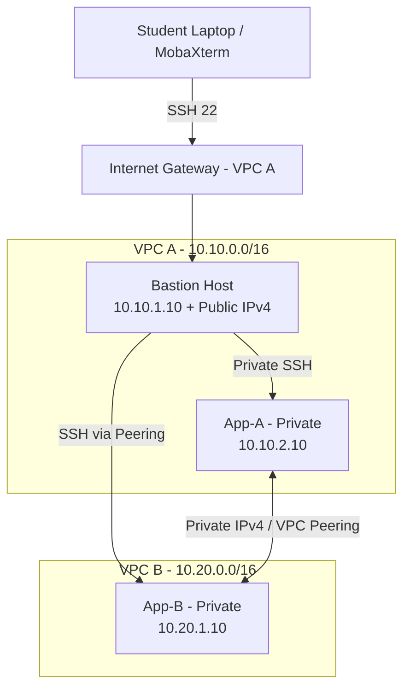

# ☁️ AWS VPC Peering — Private Network Connectivity

### EWB Cloud Labs | AWS Networking Student Project

**Two isolated VPCs · Three EC2 instances · One private peering connection**

[Project Overview](#-project-overview) • [Architecture](#-architecture) • [Implementation](#-implementation) • [Test Evidence](#-validation-and-evidence) • [Report](#-project-report)

---

## 📌 Project Overview

This EWB Cloud Labs student project demonstrates how to connect two non-overlapping Amazon Virtual Private Clouds (VPCs) using **VPC Peering**. The design keeps both application instances private and uses a public **Bastion Host** in VPC A for SSH administration. Route tables and narrowly scoped security-group rules control connectivity between the workloads.

**Objective:** Build, test and explain private IPv4 connectivity between App-A and App-B, including forward and return routing, private SSH access, and a controlled security-rule failure and recovery.

> **Evidence note:** The screenshots and final report in this repository document the actual lab execution. The configuration and test descriptions below explain the intended project design; consult the evidence for recorded results.

## 🏗️ Architecture

*The Bastion Host is the only instance with a public IPv4 address. VPC Peering does not provide VPC B with internet access through VPC A.*

### IP Address Plan

| Resource | Network / Private IPv4 | Purpose |
|---|---|---|
| `ewb-vpc-a` | `10.10.0.0/16` | First VPC |
| `ewb-a-public` | `10.10.1.0/24` | Bastion subnet |
| `ewb-a-private` | `10.10.2.0/24` | App-A subnet |
| `ewb-vpc-b` | `10.20.0.0/16` | Second VPC |
| `ewb-b-private` | `10.20.1.0/24` | App-B subnet |
| `ewb-bastion` | `10.10.1.10` | Public administration entry point |
| `ewb-app-a` | `10.10.2.10` | Private workload A |
| `ewb-app-b` | `10.20.1.10` | Private workload B |

## 🛠️ AWS Services & Tools

`Amazon VPC` · `Amazon EC2` · `VPC Peering` · `Subnets` · `Route Tables` · `Internet Gateway` · `Security Groups` · `SSH` · `MobaXterm`

## ⚙️ Implementation

1. Created two VPCs with non-overlapping IPv4 CIDR ranges and three explicitly associated subnets.
2. Attached an Internet Gateway to VPC A and configured a public route for the Bastion subnet; kept both application subnets private.
3. Configured Security Groups for laptop-to-Bastion SSH, Bastion-to-application SSH, and host-specific ICMP Echo Requests.
4. Launched three Amazon Linux 2023 EC2 instances using one lab key pair; assigned public IPv4 only to Bastion.
5. Configured private administration using MobaXterm and an SSH Gateway / jump host.
6. Created and accepted `ewb-a-b-peer`; added forward, return and Bastion-to-VPC-B routes.
7. Collected connectivity and isolation evidence, including a controlled ICMP-rule failure and recovery.

### Routing Design

| Route table | Destination | Target |
|---|---|---|
| `ewb-rt-a-public` | `0.0.0.0/0` | VPC A Internet Gateway |
| `ewb-rt-a-public` | `10.20.0.0/16` | Peering connection |
| `ewb-rt-a-private` | `10.20.0.0/16` | Peering connection |
| `ewb-rt-b-private` | `10.10.0.0/16` | Peering connection |

*Each route table also retains its automatically created local VPC route.*

## 🧪 Validation and Evidence

The workbook requires the following tests. Use the linked evidence to review the observed results:

| Test | Command / Check | Intended demonstration |
|---|---|---|
| Baseline (before peering) | App-A: `ping -c 4 10.20.1.10` | No replies before connectivity is configured |
| Forward path | App-A: `ping -c 4 10.20.1.10` | Private connectivity to App-B |
| Reverse path | App-B: `ping -c 4 10.10.2.10` | Return connectivity to App-A |
| Private SSH | MobaXterm → Bastion → App-B | Administration without an App-B public IP |
| Isolation | EC2 instance details | No public IPv4 on App-A or App-B |
| Controlled failure | Remove App-B inbound ICMP Echo Request from App-A | Ping stops |
| Recovery | Restore the same ICMP rule | Ping resumes |

### 📸 Screenshots

> Update these relative links to match the **exact names and folders** already uploaded to your repository. Remove any entry for which you do not have actual evidence.

<b>Network setup: VPCs, subnets, Internet Gateway and routes</b>

- [VPC configuration](screenshots/01-Network/VPCs.png)
- [Subnet configuration](screenshots/01-Network/Subnets.png)
- [Internet Gateway](screenshots/01-Network/Internet-Gateway.png)
- [Route tables](screenshots/01-Network/Route-Tables/)

<b>EC2 instances and security groups</b>

- [EC2 instances](screenshots/02-EC2/Instances.png)
- [Instance IP details](screenshots/02-EC2/Instance-IP-Details/)
- [Bastion security group](screenshots/03-Security-Groups/Bastion-SG.png)
- [App-A security group](screenshots/03-Security-Groups/App-A-SG.png)
- [App-B security group](screenshots/03-Security-Groups/App-B-SG.png)

<b>Peering and connectivity tests</b>

- [Active peering connection](screenshots/04-Peering/Active-Peering.png)
- [Baseline failure](screenshots/05-Connectivity-Tests/Baseline-Failure.png)
- [Forward ping](screenshots/05-Connectivity-Tests/Forward-Ping.png)
- [Reverse ping](screenshots/05-Connectivity-Tests/Reverse-Ping.png)
- [Private SSH](screenshots/05-Connectivity-Tests/Private-SSH.png)
- [Controlled failure](screenshots/05-Connectivity-Tests/Controlled-Failure.png)
- [Recovery](screenshots/05-Connectivity-Tests/Recovery.png)

<b>Cleanup evidence</b>

- [Lab cleanup](screenshots/06-Cleanup/Cleanup-Evidence.png)

## 📄 Project Report

**[View the final project report](report/YourName_EWB_VPC_Peering.pdf)**

Replace the link above with the actual path and exact filename of your uploaded PDF. The report includes implementation details, resource inventory, annotated screenshots, test results, explanations and cleanup evidence.

## 🔐 Security Notes

- Application instances have no public IPv4 addresses.
- Bastion inbound SSH is restricted to the student's current public IPv4 `/32`.
- SSH and ICMP rules use only the required host-specific sources.
- **Never commit** `.pem` private keys, credentials, passwords or access tokens.
- Lab resources should be cleaned up after saving evidence to avoid unnecessary AWS charges.

## 📚 Key Learnings

- Planning non-overlapping VPC and subnet CIDRs.
- Configuring explicit subnet associations and bidirectional peering routes.
- Understanding why an Active peering connection alone does not prove reachability.
- Administering private instances through a Bastion Host.
- Using controlled failure and recovery to validate Security Group behavior.

---

**EWB Cloud Labs — Learn · Elevate · Empower**

*AWS VPC Peering Student Project*

